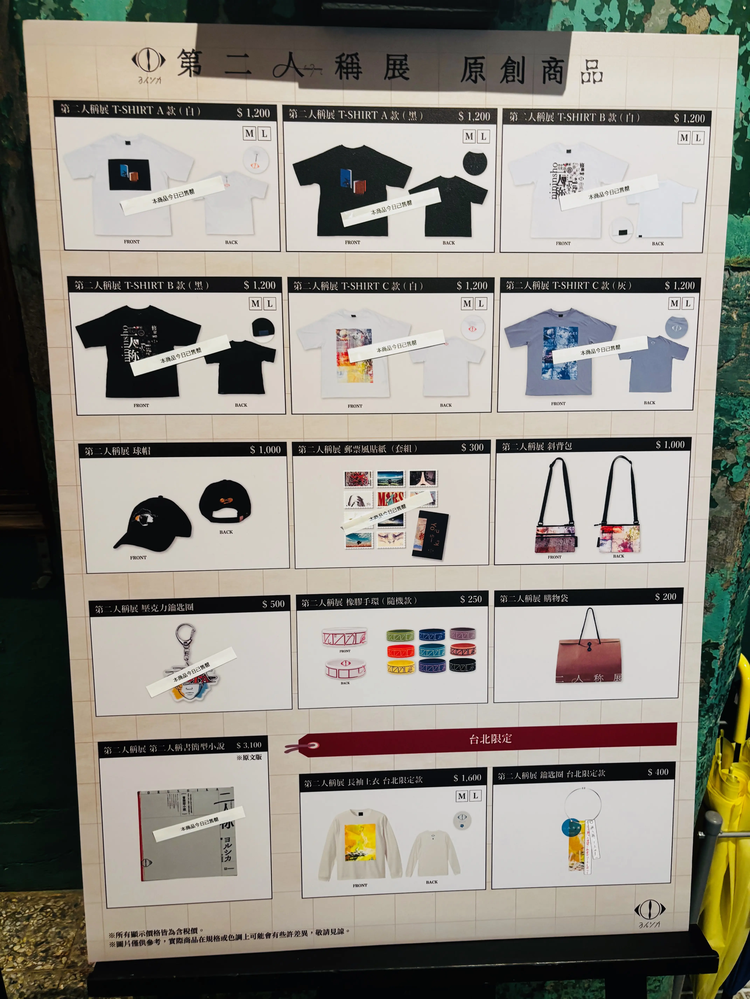
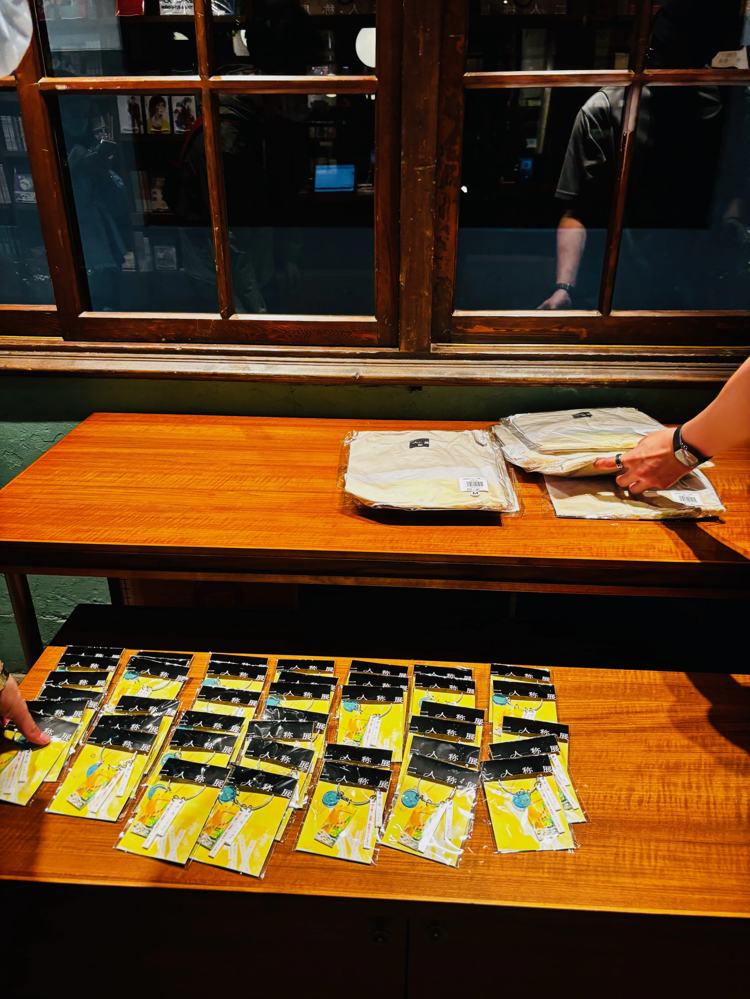
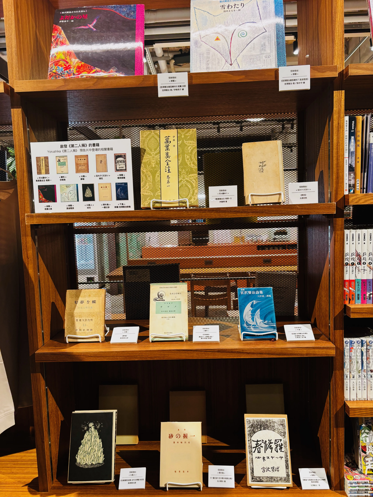
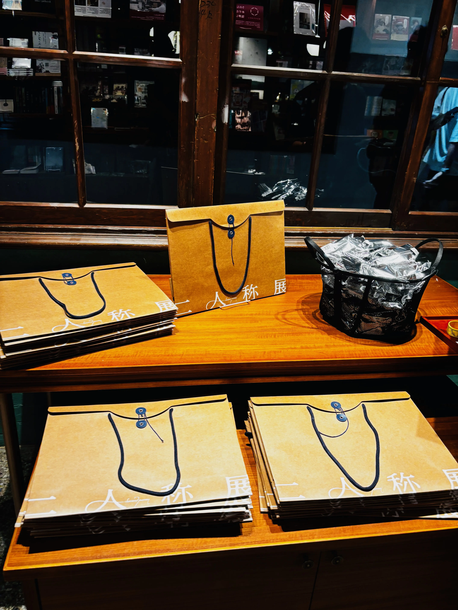
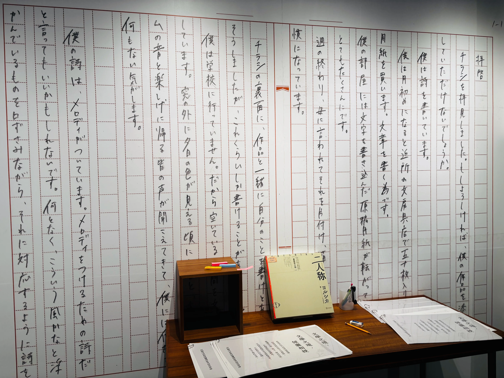
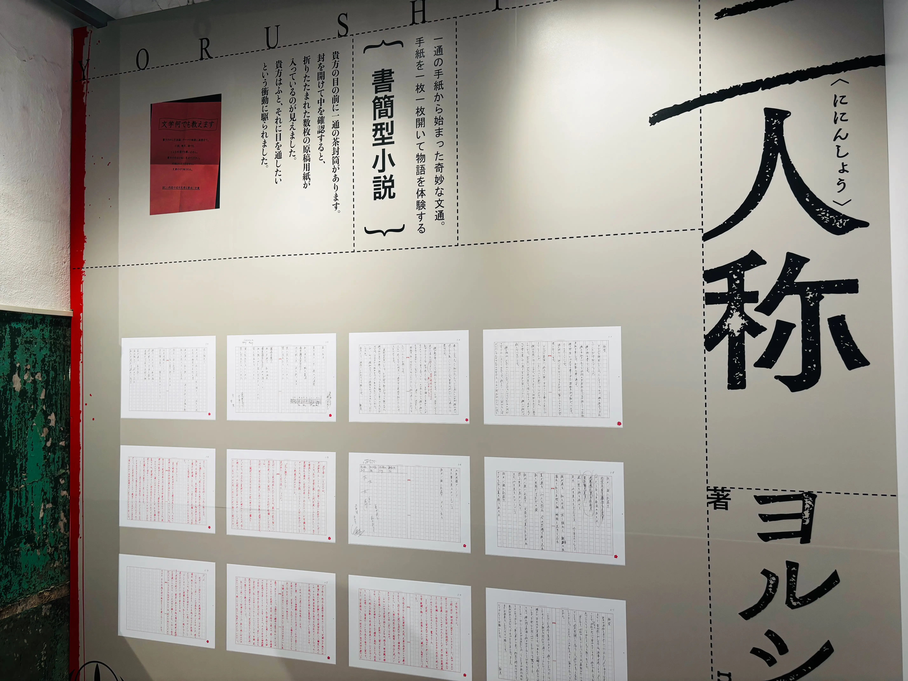
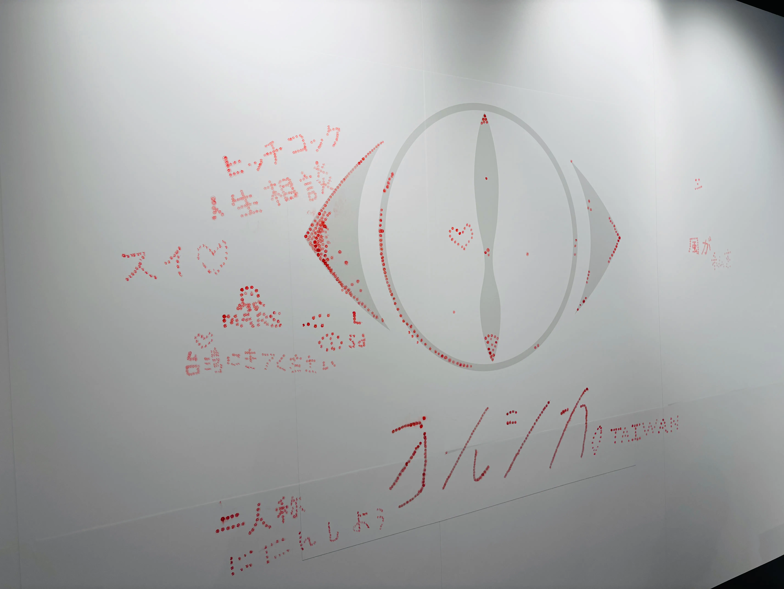

二人稱展也來台北開了，這次選點在松菸的TSUTAYA書店，有販售部分二人稱展周邊。這次我有幸搶到第一天最後一場的票，所以從台南上來看展了。

進來右側有大夜鹿布條，再往前走有一個小空間，牆上有第一封信（學生寄給老師的第一封），以及幾本1-1～2-4的翻譯。另一邊牆上有1-1～2-4的原文掃描檔。

旁邊有信紙用的櫻花印章，附贈小紙條，可以蓋完帶走。中間的牆是淺色的夜鹿，但貌似被大家拿來蓋章，我把旁邊的呼んでいる蓋完了

再往前走就是商品區，當天最後一場的20:00已經所剩無幾，聽說第二場就已經開始缺貨了，但紙袋、手環和帽子、斜背包都還有剩。現場貌似有補長袖、手環、紙袋，其他沒有看到補充。

商品區旁邊有書本展示架，是二人稱預告裡面出現的書籍，同時也是對應歌曲的靈感來源。離場填問卷有限定紙製小張書籤 

跟日本的二人稱展差距很大，也沒有原手稿展示。只能說是一個書店內的快閃小展區和商品販售而已，如果需要花超過200塊交通費前往的話就不推薦了。環球可以辦得更好，但他們不選擇這麼做，不曉得是有什麼考量。只希望環球能體會到台灣夜鹿廚的龐大，下次辦更好一點吧。

    

    
    

    

    
    

    

    
    

    

    
    

    

    
    

    

    
    

    

    
    

    

